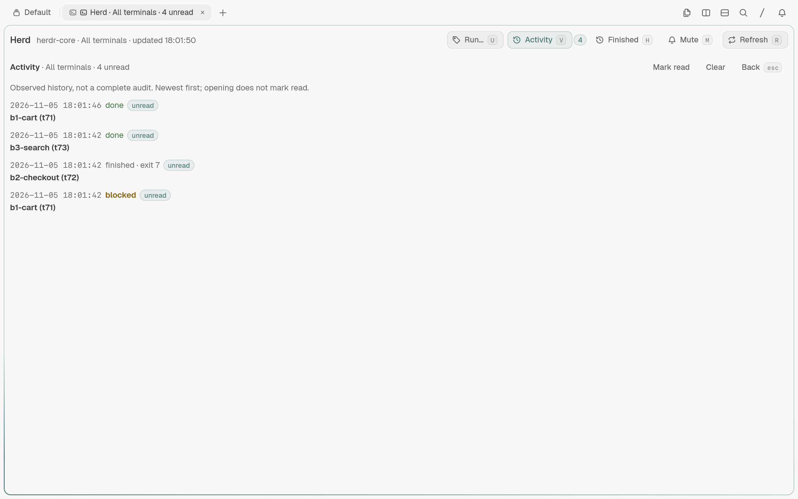
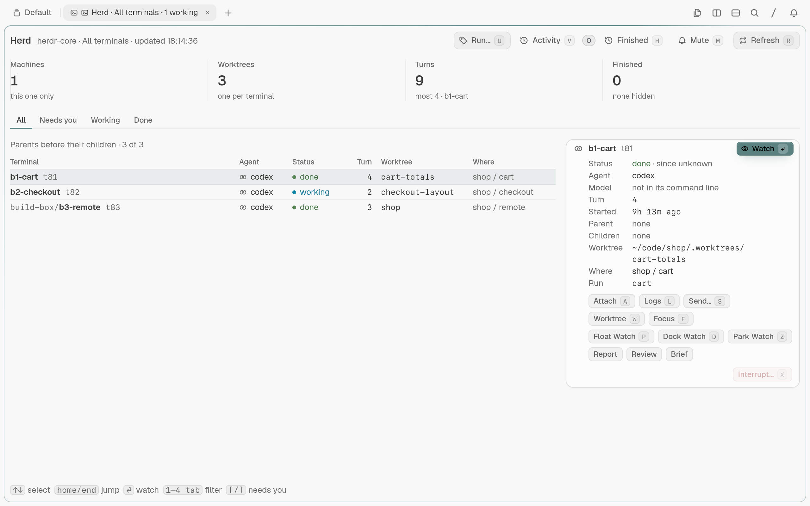

# Herd console for Tern

Watch and steer [herdr-core](https://herdr.dev) terminals and coding agents from a [Tern](https://stencil.so) block.

[](LICENSE)
[](https://github.com/DarkoKuzmanovic/tern-herd/actions/workflows/typecheck.yml)

**Unofficial — not affiliated with Stencil (Tern) or herdr.dev.** Tern and herdr-core are separate projects; this plugin connects them.

## What it adds

- A parent–child tree of terminals, with agent, status, turn counter and worktree.
- **All**, **Needs you**, **Working** and **Done** filters, subtree focus and finished terminals.
- A run picker with remembered labels: switch scopes without reopening the console.
- Next/previous needs-you navigation from any tab, with console focus and no automatic attach.
- An Activity inbox with shared unread badges, observed transition history and scope-aware Mark read/Clear.
- A selected-terminal card with model, status age, parent, worktree and exit details; logs on demand.
- Reused read-only Watch viewers, explicit float/dock/park controls, separate writable Attach, and confirmed send/interrupt actions.
- Configurable local Report/Review/Brief links, opened as native documents; Review chooses the newest file by modification time.
- Transition toasts, a mute switch and status-line counts of working, blocked, errored and unread activity.
- Responsive narrow layouts, remote-machine warnings and the last good list when `hc` stops answering.

See [the plugin guide](plugins/herd/README.md) for the details and limits, and [CHANGELOG.md](CHANGELOG.md) for releases.

## Screenshots

These show made-up data from the isolated test harness, never a real work session.


<p>
  
  
</p>






## Requirements

- **Tern 0.9.12 or later (tested on 0.9.12)**. Tern is closed beta and requires a Stencil account.
- **herdr-core `hc` 0.1.18 or later**, available from [herdr.dev](https://herdr.dev). The Herdr desktop app is not required.
- Linux is tested. **macOS is untested**; use ⌘⌥⇧H to open and ⌘⌥⇧J / ⌘⌥⇧U for next / previous needs-you.
- For development and screenshots: Bash, Git, `jq`, standard GNU command-line tools and a working Tern graphics environment. `shellcheck` is optional.

## Install

Install directly from GitHub:

```sh
tern plugin install github.com/DarkoKuzmanovic/tern-herd/plugins/herd
```

Verified on 2026-11-05 with Tern 0.9.12 in an isolated configuration: Herd 0.3.0 installed with no problems. To work from a checkout instead, clone this repository and enter its root, then:

```sh
tern plugin link plugins/herd
tern plugin list --json
```

Expect Herd `0.3.0`, `status: "ready"` and `problems: []`. Linking uses the files in place; each save hot-reloads the live plugin. After updating the checkout:

```sh
tern plugin reload herd
```

## Open and use

Choose **Open herd console** from Tern's palette, press **Ctrl+Alt+Shift+H**, or run this from a shell in the Tern window:

```sh
tern ctl plugins run plugin.herd.open
```

It focuses an existing Herd block in the current session or opens one beside the current pane. Agents remain owned by herdr-core: closing or parking a viewer does not stop them. Watch focuses its existing read-only viewer, unparking it if needed; Attach always opens a separate writable split. Viewer buttons match that read-only pane: tiled shows **Float Watch** / **Park Watch**, floating shows **Dock Watch** / **Park Watch**, and absent or parked shows neither. Keys still dispatch when a button is hidden; an inapplicable action gives a dock notice.
Viewer feedback belongs to one window replica at a time, so an unrelated
replica cannot erase those controls. If its reporter disappears, the bounded
lease expires and another capable replica can take over.

Choose **Next Herd terminal that needs you** / **Previous Herd terminal that needs you**
in the palette, or press **Ctrl+Alt+Shift+J** / **Ctrl+Alt+Shift+U** from any tab.
These focus (or unpark/open) the current session's console and cycle blocked/errored
terminals in its saved run scope, wrapping in full tree order. They only select:
no watch, attach or send happens automatically. With multiple consoles, the focused
one wins, then the most recently focused/used, then the lowest pane id.

The selected card's **Report**, **Review** and **Brief** buttons open existing
local files beside the console; missing or remote files have no buttons.
Choose **Configure Herd artifacts**
(`plugin.herd.artifacts`) to edit global relative-path specs without opening a
console; `[]` disables the links. Defaults are `.scratch/report.md`,
`.scratch/review-*.md`
(newest actual modification time), and `.scratch/brief.md`. Linux with GNU
`find` is supported; remote hc terminals and remote/unknown Tern source hosts
are refused rather than interpreting their paths on this machine. See the
[artifact guide](plugins/herd/README.md#local-artifacts) for configuration and limits.

The card shows an unknown **Model** as `—`. Status ages say `for AGE (from hc)`
when hc supplies the matching status timestamp, `for AGE (seen by Herd)` for a
change observed between polls, or `age unknown` when neither source is available.

| Key | Action |
|---|---|
| ↑ / ↓, k / j; Home / End, g / G; PgUp / PgDn | Select a terminal |
| ] / [ | Select next / previous blocked or errored terminal in this scope |
| 1–4, Tab / Shift+Tab | All / Needs you / Working / Done |
| u | Choose All terminals or a remembered/typed run label |
| Enter / o, double-click | Focus/open the selected terminal's read-only Watch viewer |
| a | Open a new writable Attach split, never reused for Watch |
| p / d / z | Float (open if absent) / dock / park the read-only Watch viewer; parked viewers require Watch to unpark, and inapplicable keys give a notice |
| l | Read the last 40 lines into a logs card |
| s | Send text after a prompt and confirmation; never forces past a prompt |
| x | Confirm an interrupt, only for working or blocked terminals |
| w | Open the local worktree in a git block |
| f | Focus the selected subtree; press again to clear |
| h | Show or hide finished terminals |
| v | Toggle the Activity inbox; opening does not mark read |
| m | Mute or unmute transition toasts |
| r | Refresh now |
| Esc | Close Activity, then logs, then clear subtree focus |

## How it works

The daemon half polls `hc ls --json --all` every two seconds and builds the terminal tree.
It looks for `hc` on PATH, then in `$HOME/.local/bin`, `/usr/local/bin` and `/usr/bin`.
Only the selected terminal gets an `hc get` request; logs are read only when asked.
The block posts each action request where only window halves with the plugin can see it.
Exactly one of them claims it and opens the split, git block or dialog; no link goes to another client, so nothing reaches a system browser.
The host rechecks confirmed send/interrupt actions against its latest terminal list.
Status counts cross to the window through scope-specific surface metadata; no separate server is added.
Finished visibility (`h`) only hides rows: the full observation still records finishes
and exit codes for non-selected terminals. Removed or unreachable terminals are not
assumed finished. [The guide explains observation limits](plugins/herd/README.md#activity-inbox).
Needs-you navigation uses that console's existing list, never a discovery request
or extra list poll. Selecting a target clears subtree focus and shows **Needs you**;
no target leaves the current view unchanged and says so. A newly opened console
defers one navigation until its normal first list arrives; changing scope cancels
that pending navigation. Opening intent is consumed once, not replayed on reload.
Cached results are explicitly marked when stale.
Activity keeps the newest 100 observed transitions in shared local metadata, with a
head badge and `N unread` in the status line even when no agents are working.
Press **v** or click **Activity** to see timestamps, terminal names/addresses,
status and exit codes. **Mark read** and **Clear** affect the current run scope
in every console; opening it does neither. Run scopes contain only known run
associations from scoped snapshots or cached selected-terminal labels.
This is observed history, not a complete audit: a console must be open and polling,
and only transitions visible in successful snapshots can be retained. The first
snapshot establishes a baseline; old finished rows do not become new activity.
Retention is bounded to 100 events, 512 terminal baselines and 12 run associations
per terminal/event; after baseline retention fills, unknown addresses are
conservatively baselined rather than resurfacing old unread news.

## Configuration and privacy

No config file is needed. Filter, subtree focus, selected terminal, finished visibility, mute and run scope survive reloads in Tern's local plugin storage. Press **u**, click **Run…**, or choose **Choose Herd run scope** in the palette to switch between **All terminals** and a run label. The picker makes one `hc --json` request to discover live labels (which `hc ls` omits), and remembers up to 12 labels, including labels seen in selected-terminal details. Bare `hc --json` was verified on installed hc 0.1.18 to return an object with `commands`, `hidden_finished`, `machines` and full `terminals` records, including `labels`; no `labels.run` value was present in the inspected live or retained finished terminals. Run-label selection is exercised with fictional fixtures, not claimed as a live-run observation. Typed labels remain available when discovery fails or a run is no longer live. A block's `run=<id>` argument supplies its initial scope; the saved choice wins on reload.

The plugin reads terminal names, working directories, machine names, command-line details and, on request, terminal output through your local `hc`. Those can contain private data. Send and Interrupt affect real terminals after confirmation. Do not publish screenshots of your live window or copy real terminal output into fixtures; all shipped examples use `/home/alex`, `shop` and `build-box`.
Activity persists only bounded transition metadata and read state, never working
directories, prompts, terminal output or command arguments. Read/clear state is
shared: changing an event through one run also changes it in All terminals and
any other associated run. History storage errors are shown instead of silently
replacing unreadable history.

## Tests and screenshots

`test/typecheck.sh` statically type-checks the plugin against Tern's own Luau declarations. It
downloads a pinned `luau-lsp` and a pinned `tern.d.luau` (both SHA-256 verified, cached and reused)
and exits nonzero on any type error:

```sh
./test/typecheck.sh
# against types generated by your own Tern instead:
tern plugin types /tmp/tern-types && ./test/typecheck.sh --defs /tmp/tern-types/tern.d.luau
```

CI runs only that check, on pushes to `main` and on pull requests
([workflow](.github/workflows/typecheck.yml)). The screenshots below come from a local harness:
Tern is closed beta, requires an account and needs a graphics environment, so it cannot render in
ordinary public CI.

The harness copies the plugin, pins a fake `hc`, isolates Tern's config/state/data/cache and daemon/control sockets, checks its assertions, and writes PNGs plus evidence to ignored `test/shots/`. It refuses to send keys until the fake `hc` is confirmed. It never needs a real agent terminal. See [test/README.md](test/README.md).

```sh
./test/shoot.sh demo empty error deep transitions degraded remote
./test/shoot.sh --size 472x1240 demo
./test/shoot.sh --keys "2" demo
./test/shoot.sh --keys "l" demo
./test/shoot.sh --keys "sleep:2100" transitions
```

## Project layout

| Path | What |
|---|---|
| `plugins/herd/plugin.toml` | Installable plugin manifest and version |
| `plugins/herd/host.luau` | Polling, tree, details, rendering and terminal actions |
| `plugins/herd/window.luau` | Palette, shortcut, splits, dialogs and status segment |
| `plugins/herd/common.luau` | Shared constants, executable candidates and link helpers |
| `plugins/herd/activity.luau` | Shared bounded activity metadata, transition baselines and unread state |
| `plugins/herd/herd.css` | Scoped responsive layout |
| `plugins/herd/viewers.luau` | Bounded viewer registry with explicit read/write, host/session and pane identity |
| `plugins/herd/artifacts.luau` | Bounded selected-only GNU find discovery, relative specs and actual-mtime selection |
| `test/` | Type-check script, isolated screenshot harness, fake `hc` and fictional fixtures |
| `docs/screenshots/` | Reviewed, metadata-stripped README screenshots |

[AGENTS.md](AGENTS.md) covers development, privacy, checks and releases.

## Third-party notices and license

MIT, see [LICENSE](LICENSE). The license covers this repository's code and documentation, not Tern, herdr-core or their trademarks. Screenshots show Tern rendering this plugin with fictional fixture data; Tern's interface and program icons belong to their respective owners. No Tern binary, fonts or third-party icon files are bundled.
