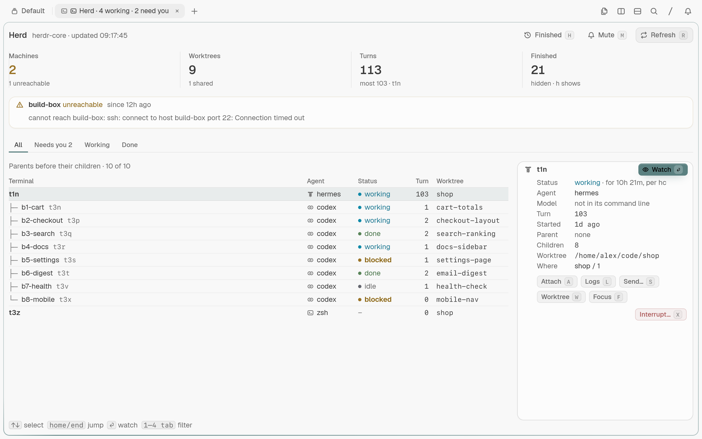
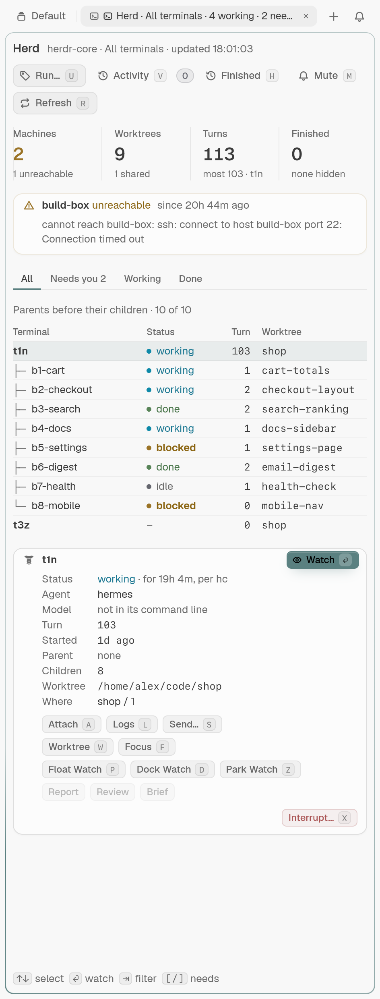
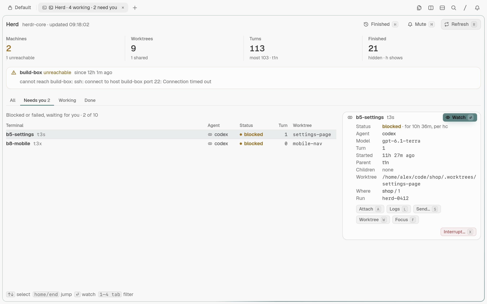
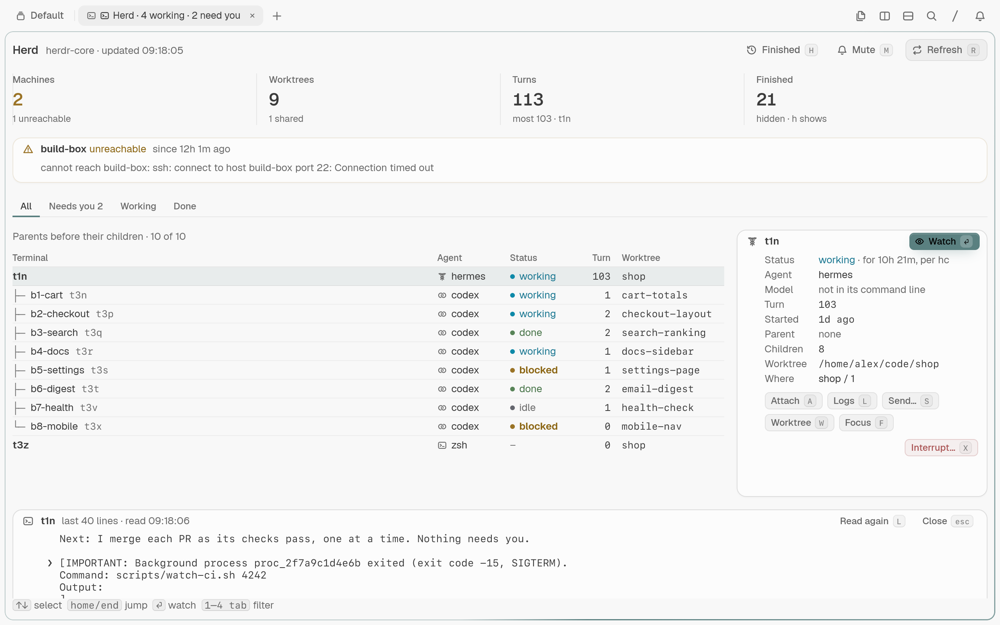
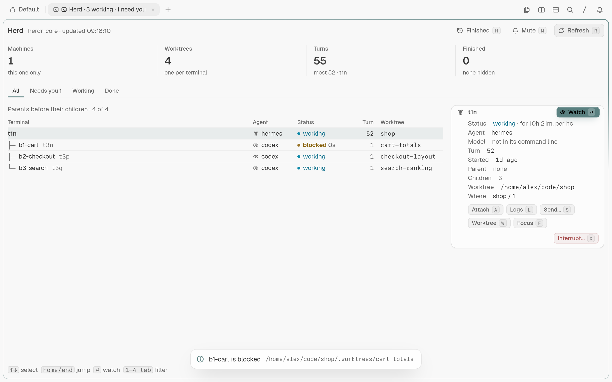
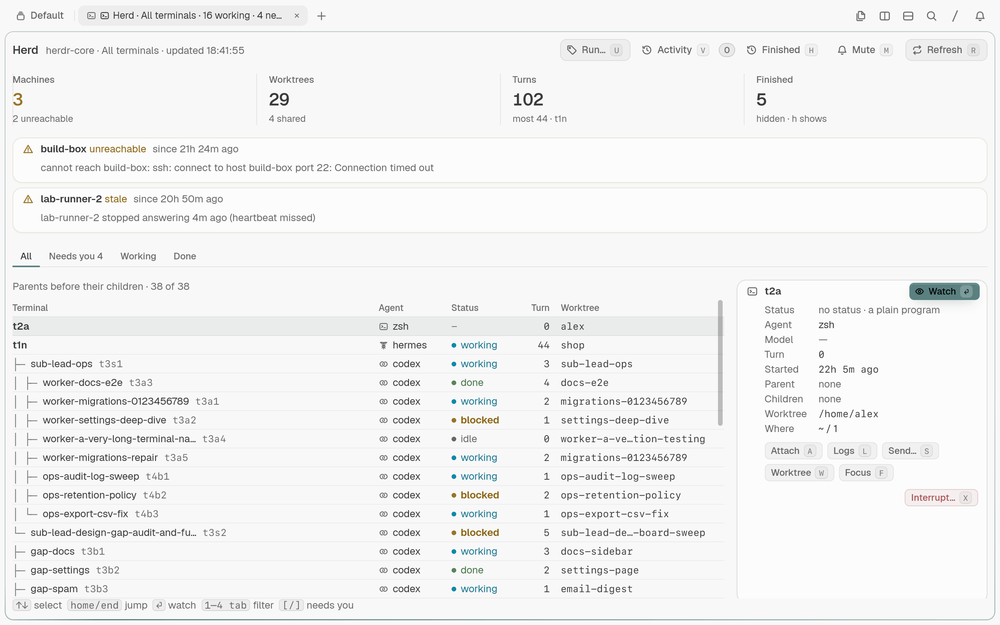

# Herd console for Tern

Watch and steer [herdr-core](https://herdr.dev) terminals and coding agents from a [Tern](https://stencil.so) block.

[](LICENSE)
[](https://github.com/DarkoKuzmanovic/tern-herd/actions/workflows/typecheck.yml)

**Unofficial — not affiliated with Stencil (Tern) or herdr.dev.** Tern and herdr-core are separate projects; this plugin connects them.

## What it adds

- A parent–child tree of terminals, with agent, status, turn counter and worktree.
- **All**, **Needs you**, **Working** and **Done** filters, subtree focus and finished terminals.
- A run picker with remembered labels: switch scopes without reopening the console.
- A selected-terminal card with model, status age, parent, worktree and exit details; logs on demand.
- Read-only watch splits, full attach splits, and confirmed send/interrupt actions.
- Transition toasts, a mute switch and a status-line count of working, blocked and errored agents.
- Responsive narrow layouts, remote-machine warnings and the last good list when `hc` stops answering.

See [the plugin guide](plugins/herd/README.md) for the details and limits, and [CHANGELOG.md](CHANGELOG.md) for releases.

## Screenshots

These show made-up data from the isolated test harness, never a real work session.



<p>
  
  
</p>







## Requirements

- **Tern 0.9.11 or later (tested on 0.9.11 and 0.9.12)**. Tern is closed beta and requires a Stencil account.
- **herdr-core `hc` 0.1.18 or later**, available from [herdr.dev](https://herdr.dev). The Herdr desktop app is not required.
- Linux is tested. **macOS is untested**; its shortcut is ⌘⌥⇧H.
- For development and screenshots: Bash, Git, `jq`, standard GNU command-line tools and a working Tern graphics environment. `shellcheck` is optional.

## Install

Install directly from GitHub:

```sh
tern plugin install github.com/DarkoKuzmanovic/tern-herd/plugins/herd
```

Verified on 2026-11-05 with Tern 0.9.12 in an isolated configuration: Herd 0.2.2 installed with no problems. To work from a checkout instead, clone this repository and enter its root, then:

```sh
tern plugin link plugins/herd
tern plugin list --json
```

Expect Herd `0.2.2`, `status: "ready"` and `problems: []`. Linking uses the files in place; each save hot-reloads the live plugin. After updating the checkout:

```sh
tern plugin reload herd
```

## Open and use

Choose **Open herd console** from Tern's palette, press **Ctrl+Alt+Shift+H**, or run this from a shell in the Tern window:

```sh
tern ctl plugins run plugin.herd.open
```

It focuses an existing Herd block or opens one beside the current pane. Agents remain owned by herdr-core: closing a viewer does not stop them. Watch is read-only; Attach lets you type and resize the terminal.

| Key | Action |
|---|---|
| ↑ / ↓, k / j; Home / End, g / G; PgUp / PgDn | Select a terminal |
| 1–4, Tab / Shift+Tab | All / Needs you / Working / Done |
| u | Choose All terminals or a remembered/typed run label |
| Enter / o, double-click | Watch in a read-only split |
| a | Attach in a writable split |
| l | Read the last 40 lines into a logs card |
| s | Send text after a prompt and confirmation; never forces past a prompt |
| x | Confirm an interrupt, only for working or blocked terminals |
| w | Open the local worktree in a git block |
| f | Focus the selected subtree; press again to clear |
| h | Show or hide finished terminals |
| m | Mute or unmute transition toasts |
| r | Refresh now |
| Esc | Close logs, then clear subtree focus |

## How it works

The daemon half polls `hc ls --json` every two seconds and builds the terminal tree.
It looks for `hc` on PATH, then in `$HOME/.local/bin`, `/usr/local/bin` and `/usr/bin`.
Only the selected terminal gets an `hc get` request; logs are read only when asked.
The block posts each action request where only window halves with the plugin can see it.
Exactly one of them claims it and opens the split, git block or dialog; no link goes to another client, so nothing reaches a system browser.
The host rechecks confirmed send/interrupt actions against its latest terminal list.
Status counts cross to the window through scope-specific surface metadata; no separate server is added.
Finished terminals can disappear between polls; [the guide explains which finishes can toast](plugins/herd/README.md#toasts).

## Configuration and privacy

No config file is needed. Filter, subtree focus, selected terminal, finished visibility, mute and run scope survive reloads in Tern's local plugin storage. Press **u**, click **Run…**, or choose **Choose Herd run scope** in the palette to switch between **All terminals** and a run label. The picker makes one `hc --json` request to discover live labels (which `hc ls` omits), and remembers up to 12 labels, including labels seen in selected-terminal details. Typed labels remain available when discovery fails or a run is no longer live. A block's `run=<id>` argument supplies its initial scope; the saved choice wins on reload.

The plugin reads terminal names, working directories, machine names, command-line details and, on request, terminal output through your local `hc`. Those can contain private data. Send and Interrupt affect real terminals after confirmation. Do not publish screenshots of your live window or copy real terminal output into fixtures; all shipped examples use `/home/alex`, `shop` and `build-box`.

## Tests and screenshots

`test/typecheck.sh` statically type-checks the plugin against Tern's own Luau declarations. It
downloads a pinned `luau-lsp` and a pinned `tern.d.luau` (both SHA-256 verified, cached and reused)
and exits nonzero on any type error:

```sh
./test/typecheck.sh
# against types generated by your own Tern instead:
tern plugin types /tmp/tern-types && ./test/typecheck.sh --defs /tmp/tern-types/tern.d.luau
```

CI runs only that check, on pushes to `main` and on pull requests
([workflow](.github/workflows/typecheck.yml)). The screenshots below come from a local harness:
Tern is closed beta, requires an account and needs a graphics environment, so it cannot render in
ordinary public CI.

The harness copies the plugin, pins a fake `hc`, isolates Tern's config/state/data/cache and daemon/control sockets, checks its assertions, and writes PNGs plus evidence to ignored `test/shots/`. It refuses to send keys until the fake `hc` is confirmed. It never needs a real agent terminal. See [test/README.md](test/README.md).

```sh
./test/shoot.sh demo empty error deep transitions degraded remote
./test/shoot.sh --size 472x1240 demo
./test/shoot.sh --keys "2" demo
./test/shoot.sh --keys "l" demo
./test/shoot.sh --keys "sleep:2100" transitions
```

## Project layout

| Path | What |
|---|---|
| `plugins/herd/plugin.toml` | Installable plugin manifest and version |
| `plugins/herd/host.luau` | Polling, tree, details, rendering and terminal actions |
| `plugins/herd/window.luau` | Palette, shortcut, splits, dialogs and status segment |
| `plugins/herd/common.luau` | Shared constants, executable candidates and link helpers |
| `plugins/herd/herd.css` | Scoped responsive layout |
| `test/` | Type-check script, isolated screenshot harness, fake `hc` and fictional fixtures |
| `docs/screenshots/` | Reviewed, metadata-stripped README screenshots |

[AGENTS.md](AGENTS.md) covers development, privacy, checks and releases.

## Third-party notices and license

MIT, see [LICENSE](LICENSE). The license covers this repository's code and documentation, not Tern, herdr-core or their trademarks. Screenshots show Tern rendering this plugin with fictional fixture data; Tern's interface and program icons belong to their respective owners. No Tern binary, fonts or third-party icon files are bundled.
